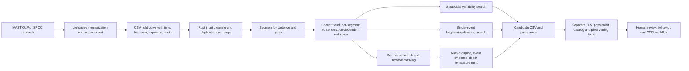

# Repository inventory

**Evidence point:** source tree at `fc0e95e99faddb92f20d5b94d6319ce4df33c9fc`.

## Mission actually implemented

**VERIFIED.** This is a TESS-style stellar light-curve candidate triage system.
The Rust CLI reads positive-flux CSV/TSV data. It screens for periodic transit
dips, sinusoidal variability, and isolated brightening/dimming events. The
Python front end discovers and downloads TESS QLP/SPOC products, normalizes and
stitches sectors, and invokes Rust. Candidate refinement, catalog checks,
pixel diagnostics, false-positive probability, and a CTOI gate exist as
separate Python utilities.

The current program does **not** ingest TESS pixel cubes as its discovery
search, detect moving asteroids/comets from images, discover image transients,
or identify exocomets. A sinusoid in a supplied asteroid light curve is not an
asteroid detector. The software outputs detections for human vetting; it does
not establish new discoveries. These boundaries are documented in
[README.md](/Users/danny/dev/astronomy/README.md:3) and
[README.md](/Users/danny/dev/astronomy/README.md:210).

## Actual processing architecture

The Rust library describes these stages in
[src/lib.rs](/Users/danny/dev/astronomy/src/lib.rs:1). Candidate classification
is downstream: the project labels a transit signal as screening/detection by
the jackknife score, but even a detection tier is not a planet confirmation.
See [scripts/vetting/gate.py](/Users/danny/dev/astronomy/scripts/vetting/gate.py:133)
and [README.md](/Users/danny/dev/astronomy/README.md:214).

## Algorithms and modules

- **Preprocessing:** cadence/gap segmentation, within-segment robust detrending,
  uncertainty normalization, duration-binned correlated-noise correction.
- **Transit detection:** weighted phase-folded box search; period/duration grid;
  repeated strongest-signal masking; multi-event checks; alias grouping;
  event evidence; post-search depth remeasurement.
- **Variability:** sinusoid scan using recurrence and segment mean removal.
- **Single events:** isolated brightenings and dimmings, with periodic duplicates
  suppressed.
- **Optional independent screen:** iterative TLS using limb-darkened templates.
- **Follow-up tools:** transit fit, odd/even and secondary eclipse checks,
  sector depth consistency, catalog cross-checks, Gaia neighbors, pixel centroid,
  FPP/FPP-nearby, empirical nulls, and a human-gated CTOI checklist.

The primary Rust transit model remains a box screen; the physical model and TLS
are separate paths. This distinction matters when comparing to research that
reports improved small-planet recovery using TLS. The local detrending method is
inspired by Wōtan's time-windowed Tukey biweight benchmark; it is not a direct
Wōtan implementation.

## Inputs, output, and operations

Supported discovery data are one-dimensional time series exported from public
TESS products. Search bounds, period trial count, transit passes, thread count,
trend method, and grouping are CLI settings. The Python survey runner stores
per-sector CSVs, combined curves, logs, manifests, checksums, and a SQLite
resume ledger. It can keep QLP and SPOC runs separate for independent
comparison.

Output is candidate rows plus event-level diagnostics, periodogram warnings,
and optional provenance. Results do not carry a calibrated object probability;
the threshold is a tier for triage.

## Supported object classes

| Class | Actual support | Review status |
| --- | --- | --- |
| Periodic transit-like dips | Yes; box search, iterative masking, alias grouping | Core feature, benchmarked here |
| Eclipsing binaries / blended events | Can trigger transit candidates; auxiliary vetting tools address some cases | Not a dedicated binary classifier; hard-negative benchmark absent |
| Sinusoidal stellar variability | Yes | A detector class, not physical classification |
| Flares / isolated dimming or brightening | Isolated excursions can be flagged | Candidate triage only |
| Asteroids and comets | No image-level/moving-object search | Unsupported |
| Transients from pixels/images | No | Unsupported |
| Other anomalous signals | Only if they resemble implemented time-series shapes | Not a general anomaly detector |

## Repository and benchmark state

**VERIFIED.** HEAD is `fc0e95e99faddb92f20d5b94d6319ce4df33c9fc` on `main`.
There were no tracked modifications at review start. An unrelated untracked file,
`4206066_gaia_background.csv`, was present and preserved. Local `.env`, virtual
environment, target artifacts, and generated benchmark data are ignored.

The `research-review` package and three evaluation tools added by this review
are uncommitted working-tree files; the repository's Git metadata is read-only
in this environment, so a review branch could not be created. See
[environment.md](environment.md).
